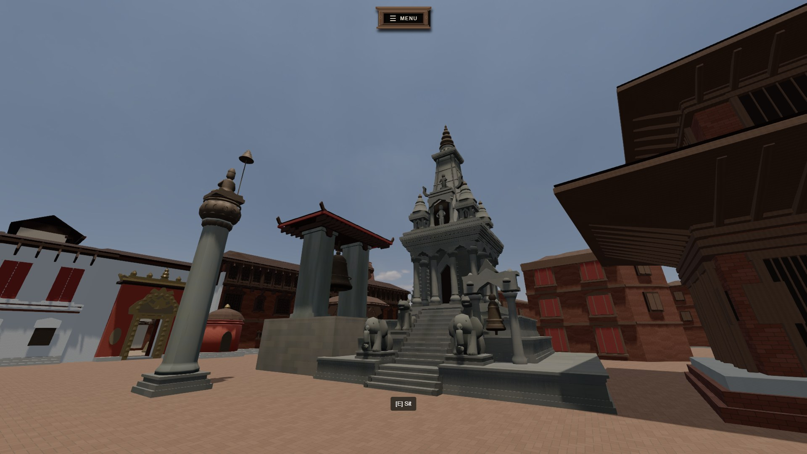
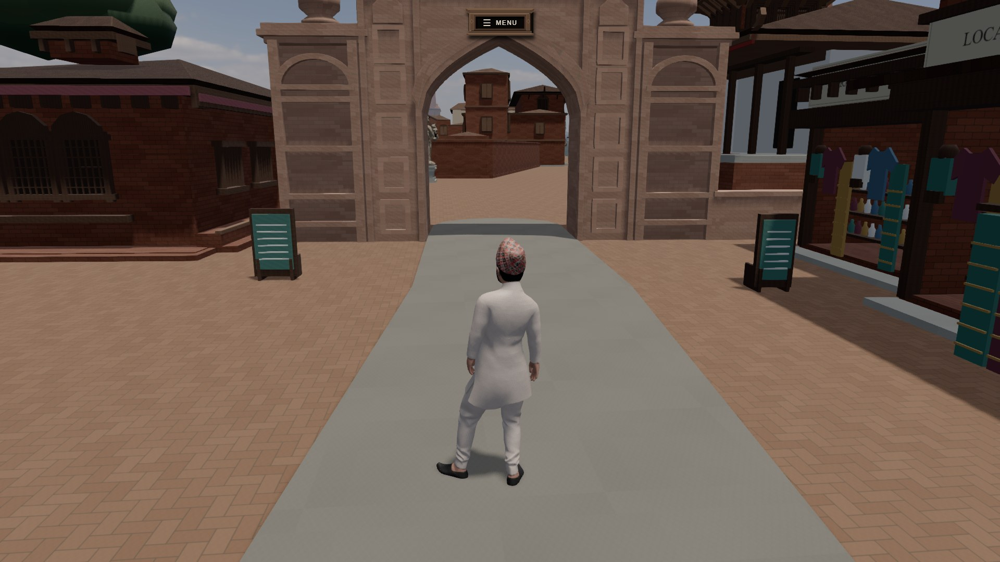
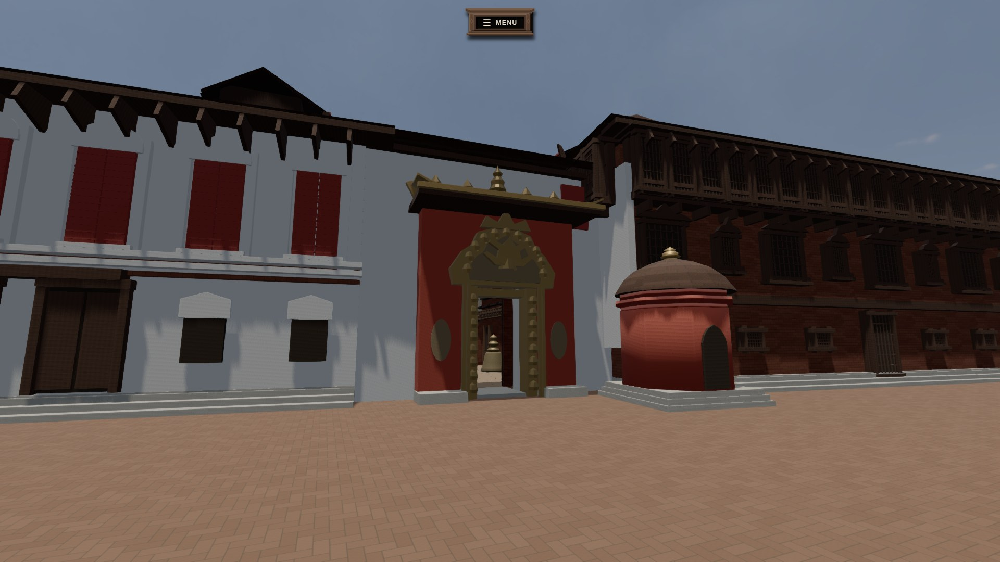
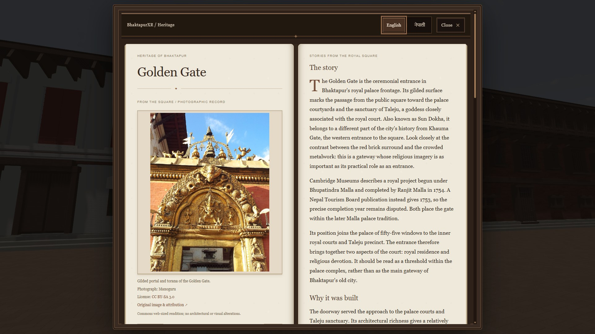
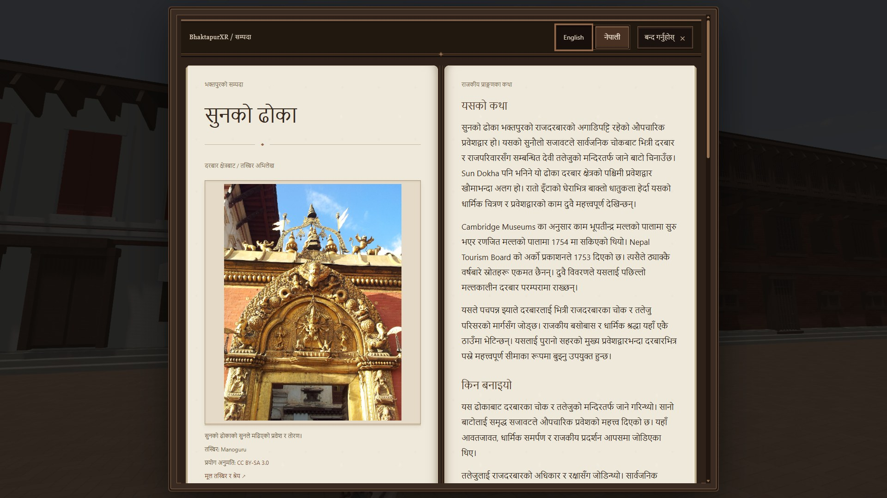

# BhaktapurXR

A browser-based 3D exploration and experimental reconstruction of **Bhaktapur Durbar Square, Nepal**.


> [!WARNING]
> **Under active development.** Large portions of the square remain unfinished, simplified, approximate, provisional or placeholders. Some areas await stronger historical or photographic evidence and may be redesigned. Architecture and interactive systems are incomplete. **This is not a definitive representation, a surveyed digital twin or a finished heritage reconstruction.**



*Current in-development BhaktapurXR gameplay, captured locally on 24 October 2026. Visual and architectural details are subject to change. These are rendered game views, not photographs of the real square.*

**[Live Development Build](https://bhaktapurxr.motioncricket.workers.dev)** · [GitHub repository](https://github.com/Basilisk2061/BhaktapurXR)

The deployed build may change frequently and can differ from the local screenshots or the current repository revision.

## Overview

BhaktapurXR explores how cultural heritage can be experienced interactively on the web. It combines third-person exploration, real-time rendering, heritage research and an English/Nepali monument guide. The focus is the square and selected adjoining spaces, rather than a model of the whole city.

The reconstruction draws on plans, photographs, conservation reports and institutional accounts. Those sources support different conclusions: a map may help locate a building without establishing its height; a photograph may show a roof without explaining its foundation history. The project records these distinctions instead of treating every visible surface as equally certain.

**BhaktapurXR is an independent experimental project.** It is not an official reconstruction produced or endorsed by UNESCO, Nepal's Department of Archaeology or Bhaktapur Municipality. These organizations appear as research sources, not partners or endorsers.

## Current development screenshots

<table>
  <tr>
    <td width="50%"><br><em>Third-person exploration at Khauma Gate.</em></td>
    <td width="50%"><br><em>Golden Gate and selected palace frontage.</em></td>
  </tr>
  <tr>
    <td><br><em>Heritage Book — English.</em></td>
    <td><br><em>Heritage Book — नेपाली.</em></td>
  </tr>
</table>

Screenshots use the local working arrangement and High graphics. Existing ground-level review poses were used for architectural framing; development labels were hidden for capture. No world geometry was changed. The book contains third-party photography, distinct from the game view: Golden Gate photograph by **Manoguru**, [original file and attribution](https://commons.wikimedia.org/wiki/File:Golden_Gate_at_Bhaktapur_Durbar_Square.jpg), [CC BY-SA 3.0](https://creativecommons.org/licenses/by-sa/3.0/), displayed without architectural or visual alteration.

## What is implemented

| Area | Current functionality |
| --- | --- |
| Exploration | Animated third-person character; walking, running and jumping; collision-aware follow camera; supported arcade sitting/standing. |
| Mobile | Touch movement joystick, touch camera, Jump and contextual Sit/Stand controls, menu and fullscreen/orientation handling. Device support still needs manual review. |
| Reconstruction | Individually developed monument families, selected palace frontage, entrance areas, raised platforms, enclosure walls and contextual buildings. |
| Heritage | Proximity-based monument information, photographs, historical interpretation, timelines, sources and reconstruction evidence. |
| Living environment | Four scripted NPC instances using two character assets, with walking/idle/sitting behavior, a phone animation and selected reactive voices. This is not conversational or generative AI. |
| Sound | Square ambience, animation-contact footsteps, landing sounds and positional NPC voices, subject to browser audio activation. |
| Graphics | Very Low, Low, Medium and High presets. High adds a locally hosted HDR environment, selected PBR detail maps, shadows and FXAA. Lower presets reduce rendering cost. |
| Tools | Development-only World Editor with assembly/part selection, transforms, primitives and saved manual overrides; spatial and evidence documentation. |

The current world mounts its architectural assemblies together. Distance-based geometry streaming is not part of normal exploration. Performance and visual consistency vary by device; no frame-rate guarantee is made.

### Heritage Book

The timber-framed, lokta-paper-inspired book uses a two-page desktop spread and a single-page mobile layout. Its **English | नेपाली** selector changes the complete entry and remembers the choice locally. Both languages are static project content; switching does not contact a translation service.

The 12 entries cover Golden Gate, Fifty-Five Window Palace, National Art Gallery, Gopinath/Dwarika/Krishna, Vatsala Durga, Taleju Bell, Bhupatindra Malla's column, Chyasilin Mandap, Khauma Gate, Yaksheshwar/Pashupatinath, Siddhi Lakshmi and Silu Mahadev/Fasi Dega.

English is the canonical researched text. Nepali preserves qualified dates, disputed patronage and unresolved identities. Publication titles and attribution remain in their original form. The guide separates monument history from the limitations of the modeled representation.

## Historical & architectural accuracy

**The current environment may not look exactly like the real Bhaktapur Durbar Square.** Buildings, proportions, façades, roofs, courtyards, decorative details, materials and spatial relationships can differ from their real counterparts. Recognizable architecture does not establish measured accuracy.

These differences reflect incomplete evidence, inaccessible or private spaces, conflicting historical sources, limited calibrated measurements, ongoing revision, performance constraints and provisional geometry. Some structures have stronger evidence than others. Identity, position, dimensions and architectural form must therefore be assessed separately.

Documenting uncertainty is part of the reconstruction method. A photograph-derived façade is not a surveyed elevation; a documented restoration does not establish an original founding date. Conflicting accounts remain qualified rather than being combined into a falsely precise story.

Modeled palace passages also do not establish present-day visitor access, photography permissions or access to sacred interiors. The project does not reconstruct restricted ritual content or claim authority over living religious practice.

### Evidence-aware workflow

```text
Historical maps and spatial plans
    → approximate spatial calibration
    → photographic/reference comparison
    → research and conservation reports
    → architectural reconstruction
    → manual visual review and revision
    → recorded confidence and unresolved questions
```

This is iterative, not a claim that every assembly has final visual approval. Recognizable monuments are developed from identified evidence rather than randomly generated as generic Newar buildings. Contextual masses have a different evidential role from reconstructed landmarks.

The repository has related classifications in different datasets; they are not interchangeable grades of overall quality:

| Classification | Meaning in the project |
| --- | --- |
| `VERIFIED` | Supported for the specific fact or field being assessed; does not certify the entire model. |
| `SOURCE_DERIVED` | Derived from an identified source, such as traced plan linework; inherits its limitations. |
| `PHOTO_INFERRED` | Interpreted from photographs; perspective and unseen surfaces remain limitations. |
| `APPROXIMATE` | Estimated position, dimension or form rather than surveyed precision. |
| `PLACEHOLDER` | Temporary representation without a claim of faithful reconstruction. |
| `UNRESOLVED` | Reconstruction data lacks enough evidence to settle the question. |
| `PROVISIONAL` | Tentative interpretation; also used in the heritage guide. |
| `UNKNOWN` | Heritage-guide field without an established answer. |

These names come from the [spatial schema](src/data/reconstruction/types.ts) and [heritage schema](src/game/heritage/types.ts). Additional context/identity labels occur in individual audits; consult their definitions before treating a label as verification.

## Reconstruction status

**More developed and repeatedly refined:** Khauma's entrance and adjoining boundary, the western monument group, selected palace/museum frontage, Golden Gate, the Vatsala/bell/column ensemble, selected eastern monuments, sitting arcades and the Yama Dwar entrance composition. Taleju work also includes a modeled Mul Chowk and connecting ranges.

**Still incomplete or requiring further evidence:** hidden/reverse elevations, fine carving and sculpture, parts of the palace courtyard sequence, deeper precinct spaces, Beko connections and surrounding context, exact dimensions, materials and broader environmental population. Existing court connections include approximate geometry; their presence does not mean the whole palace is reconstructed.

Manual comparison and historical validation remain ongoing. There is no defensible completion percentage. Older phase documents record earlier decisions and rejected interpretations; read later corrections before treating an old report as the current specification.

## Technology and architecture

Declared versions in the current `package.json`:

| Layer | Technology |
| --- | --- |
| Application | Next.js 16.4.1 App Router; React 19.3.0; TypeScript 6.0.3 |
| Rendering | Three.js 0.186.1; React Three Fiber 9.8.1; Drei 10.7.9 |
| Physics/state | React Three Rapier 2.2.0; Zustand 5.0.15 |
| Styling | CSS and Tailwind CSS 4.3.3 |
| Deployment | OpenNext Cloudflare 1.20.12; Wrangler 4.151.1; Cloudflare Workers |

Next.js owns the main menu, routes and UI. The client-side R3F Canvas composes procedural/instanced architecture, character assets, Rapier physics, lighting and audio. Player, NPC and heritage modules are separate. Source traces, correction layers and saved editor overrides feed the reconstruction; heritage presentation shares research metadata between languages. Development APIs support local editing, not a public content-management backend.

```text
src/app/                 App Router pages and development APIs
src/components/          Main menu, controls, settings and Heritage Book
src/game/                Architecture, rendering, player, NPCs, audio, heritage
src/data/reconstruction/ Spatial sources, traces, calibration and evidence
src/features/            Bhaktapur saved arrangement and World Editor
public/                  Runtime models, textures, audio, fonts and photos
docs/                    Research dossiers, audits and implementation notes
reference/               Research material; redistribution rights vary
scripts/                 Data preparation and asset-processing utilities
```

## Getting started

Use **npm**. The repository's `.node-version` selects **Node.js 22.20.0**; use that version for a consistent setup. A current WebGL-capable browser is required. A desktop GPU is preferable for High; start lower on mobile or integrated graphics.

```bash
git clone https://github.com/Basilisk2061/BhaktapurXR.git
cd BhaktapurXR
npm ci
npm run dev
```

Open [localhost:3000](http://localhost:3000), then choose PLAY, or navigate directly to `/explore?world=bhaktapur`. The `predev` script prepares generated world data automatically. No application API key or backend account is required for local exploration. `.env.example` contains optional development flags, not required credentials.

For phone/LAN access, bind the development server explicitly:

```bash
npm run dev -- --hostname=0.0.0.0
```

Use the development computer's LAN address and printed port on the same network. The existing `allowedDevOrigins` configuration discovers local IPv4 interfaces; restart the server after changing networks. Browser fullscreen and orientation behavior can differ between local HTTP and deployed HTTPS.

### Controls

Desktop: click the scene to engage the camera, WASD to move, Shift to run and Space to jump. Escape releases the mouse. Use the displayed contextual prompt for heritage or seating. Mobile provides the joystick, drag-to-look area and action buttons. Settings are available through the game menu.

For development, open `/explore?world=bhaktapur&editor=1` locally. See [World Editor controls](docs/world-editor.md). Editor routes and save APIs are development-only; deployed Workers use bundled saved overrides rather than writing to the repository.

## Build and deployment

Local Next.js production build:

```bash
npm run build
npm start
```

Cloudflare's separate OpenNext workflow:

```bash
npm run build:cloudflare
npm run preview:cloudflare
# Only when intentionally deploying with your own Cloudflare account:
npm run deploy:cloudflare
```

The Worker is named `bhaktapurxr`. This configuration is **not a static Pages export**. Keep the preparation hooks: generated data is intentionally ignored by Git and produced before development/build. See [deployment notes](docs/cloudflare-deployment.md), including bundled override behavior. Publishing local editor changes requires a separate deliberate commit; a Git-connected build only receives committed data.

## Roadmap

Subject to evidence, review and technical constraints; no release dates are promised:

- **Reconstruction:** refine remaining buildings and court connections, improve architectural details and strengthen spatial calibration.
- **Heritage:** improve citations, interpretation and translation review; investigate unresolved identities without forcing a complete narrative.
- **World:** develop ambient life, NPC behavior and soundscape while retaining clarity and performance.
- **Technical:** improve mobile rendering, accessibility, startup and deployment reliability; optimize detail without breaking whole architectural assemblies.

## Research and sources

Research includes UNESCO-hosted submissions, Department of Archaeology conservation reports, architectural plans, historical photographs, licensed contemporary images and academic/institutional interpretation. References are evidence, not endorsement.

Start with the [heritage research index](docs/heritage-research/README.md), [source ledger](docs/reconstruction-sources.md), [world-data conventions](docs/world-data.md), [central forecourt verification](docs/central-forecourt-verification.md), and [Yama Dwar spatial audit](docs/research/yama-dwar-spatial-audit.md). The [heritage image manifest](docs/heritage-research/image-manifest.json) records creators, source links and licenses. Research-access limitations and contradictory accounts are recorded alongside conclusions.

## Contributing and corrections

Historical corrections, stronger primary/academic sources, documented architectural references, bug reports, performance work and accessibility improvements are welcome. Discuss substantial changes before submitting a broad redesign.

For an architectural or historical correction, open an issue identifying the monument/area, explain the discrepancy, and provide a source or reference where possible. Include the source date and distinguish measured evidence from a visual impression. For bugs, include reproduction steps, device/browser, graphics preset and relevant screenshots, without private information or credentials.

Do not present an attractive redesign as historically accurate without evidence. Sources may disagree; a useful contribution can document that conflict rather than choose an unsupported answer.

## Third-party material and licensing

**No root source-code LICENSE is currently included.** Public visibility alone does not grant a general reuse license. A project license must be selected explicitly by the owner; this README does not introduce one.

Third-party reference photographs and research materials retain their respective rights and are not covered by a project source-code license unless explicitly stated. Local research access does not establish permission to redistribute. Review tracked research photographs/PDFs and local reference folders before making the repository public; an attribution is not itself a redistribution grant.

- Runtime heritage photographs have individual Commons credits and CC BY-SA/CC0 terms in the image manifest and book. Retain those terms and attribution when reusing them.
- The [Digital Himalaya plan and derived tracing data](reference/bhaktapur/digital-himalaya/ATTRIBUTION.md) carry CC BY-SA 3.0 terms.
- The [OpenStreetMap extract](reference/bhaktapur/urban/ATTRIBUTION.md) is separately attributed under ODbL 1.0.
- [High graphics assets](docs/high-graphics-assets.md) include locally hosted Poly Haven CC0 material and environment maps.
- Character, animation, audio, font and other supplied-asset redistribution terms need their own review; import manifests alone are not license grants.

The README screenshots document the prototype, not ownership of every underlying asset. They do not relicense the reference photograph visible inside the book or other third-party content.

## Acknowledgments

The source documentation acknowledges the historians, conservation authors, photographers, map contributors and craftspeople whose recorded work informs the project. UNESCO, the Department of Archaeology, Bhaktapur Municipality, NTB, institutional collections and universities are referenced as sources only. Photography credits remain attached to individual images; no collaboration or institutional endorsement is implied.

